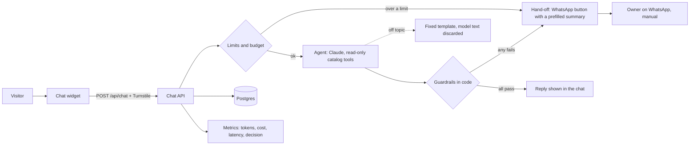

# Architecture

One Astro project, deployed as one Cloudflare Worker. Public pages are static files; the server parts are on-demand routes in the same Worker. Decisions and rejected alternatives are in [adr/](adr/README.md).

Status today: the static site is live (hosting moved to Cloudflare Workers in REL-54). The backend, analytics and assistant below are planned in the tickets named in each diagram.

## Website chat (REL-55, REL-56, REL-40)



The model's text reaches the visitor only if every guardrail passes (ADR-007).

## Analytics (REL-49, REL-50, REL-51, REL-52)

```mermaid
flowchart LR
  P[Pages] -->|tiny tracker, no cookies| C[/api/collect]
  C --> E[(events)]
  E --> J[Cron job: daily rollups and retention]
  J --> D[(daily rollups)]
  G1[Search Console] --> J2[Cron job: daily import]
  G2[Business Profile] --> J2
  J2 --> D
  D --> Q[Query API]
  Q --> B[/admin dashboard, Clerk sign-in/]
```

## Owner console (REL-48, REL-41)

```mermaid
flowchart LR
  Ow[Owner] --> Cl[Clerk sign-in, email allowlist]
  Cl --> Ad[/admin]
  Ad --> S[Analytics dashboard]
  Ad --> Cv[Conversations: transcripts, flag wrong answers]
  Ad --> K[Controls: chat on or off]
  Cv --> Ev[Eval candidates]
```

## Where the code lives

| Area                       | Folder                                     |
| -------------------------- | ------------------------------------------ |
| Public pages and views     | `src/pages/`, `src/views/`                 |
| Business facts and catalog | `src/config/`, `src/data/`                 |
| Server code                | `src/server/` (env, db; later agent, jobs) |
| API routes                 | `src/pages/api/` (`prerender = false`)     |
| Migrations                 | `drizzle/`                                 |
| Evaluations (planned)      | `evals/`                                   |
| Hosting and headers        | `wrangler.jsonc`, `public/_headers`        |

## Environments

- **Production:** `www.masajesrelaxmty.com`, built from `main` by Cloudflare Workers Builds.
- **Previews:** one URL per branch, built by the same service.
- **Local:** `npm run dev`; real client messages and real API keys are never used in local data or tests.
